<p align="center">
  
</p>

<h1 align="center">REZKA — HDrezka для macOS</h1>

<p align="center">
  Неофициальный клиент HDrezka для Mac на SwiftUI + AVKit. Фильмы, сериалы, мультфильмы и аниме
  в нативном окне с боковым меню, горячими клавишами и плеером в отдельном окне.
</p>

<p align="center">
  
  
  
  
</p>

> 📬 **По всем вопросам:** [mrgsdev@gmail.com](mailto:mrgsdev@gmail.com)
>
> 📺 **Версия для Apple TV:** [HDRezka_Apple_TV](https://github.com/mrgsdev/HDRezka_Apple_TV)

## Содержание

- [Возможности](#возможности)
  - [Главная](#главная)
  - [Каталоги, жанры и «Лучшие»](#каталоги-жанры-и-лучшие)
  - [Подборки и анонсы](#подборки-и-анонсы)
  - [Карточка фильма и сериала](#карточка-фильма-и-сериала)
  - [Плеер](#плеер)
  - [Закладки, поиск и настройки](#закладки-поиск-и-настройки)
  - [Вход в аккаунт](#вход-в-аккаунт)
  - [Обновления](#обновления)
  - [Горячие клавиши](#горячие-клавиши)
- [Установка](#установка)
- [Сборка из исходников](#сборка-из-исходников)
- [Выпуск новой версии](#выпуск-новой-версии)
- [Структура проекта](#структура-проекта)
- [Отладка](#отладка)

## Возможности

### Главная

<table>
  <tr>
    <td width="50%">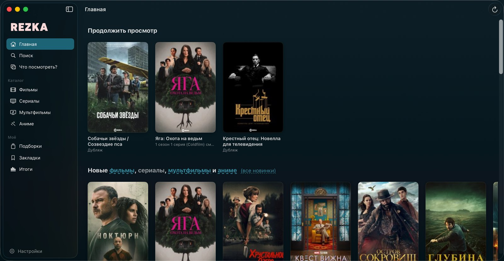</td>
    <td width="50%">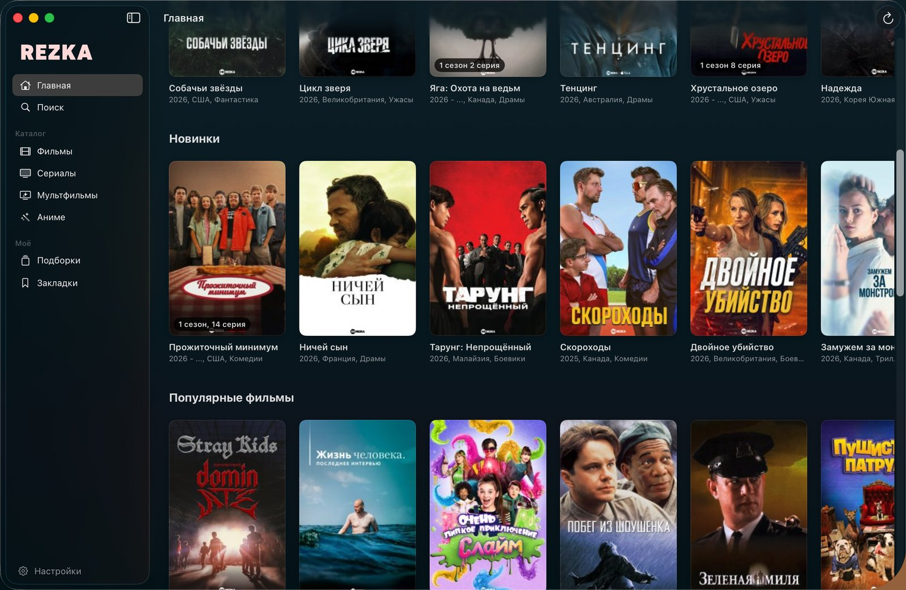</td>
  </tr>
</table>

- «Продолжить просмотр» синхронизируется с сайтом; правый клик по постеру убирает его из списка.
- «Новые фильмы, сериалы, мультфильмы и аниме» — тот же слайдер, что на главной сайта, с бейджами новых серий.
- Новинки, популярные фильмы и сериалы, «Сейчас смотрят», мультфильмы, аниме. ⌘R обновляет полки.

### Каталоги, жанры и «Лучшие»

<table>
  <tr>
    <td width="50%">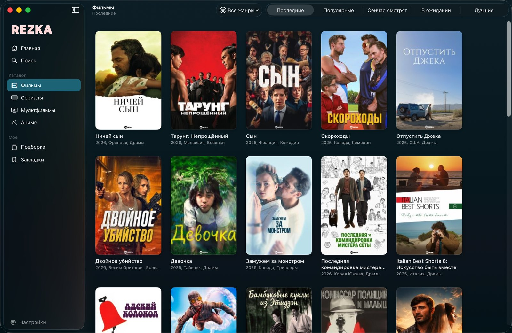</td>
    <td width="50%">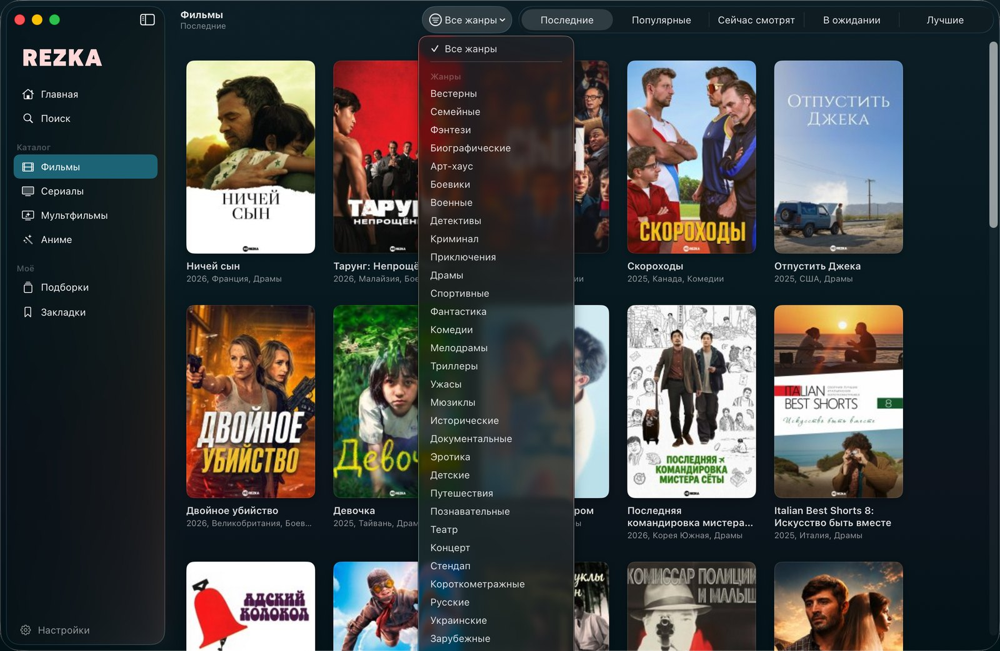</td>
  </tr>
  <tr>
    <td colspan="2" align="center">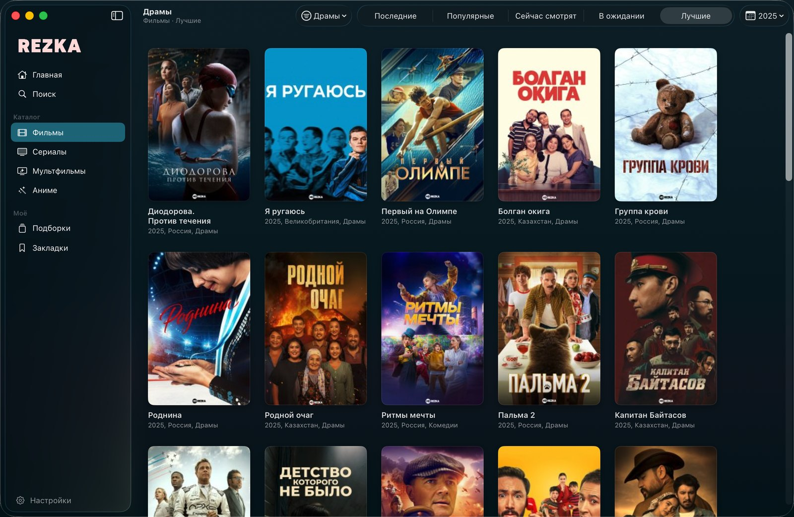</td>
  </tr>
</table>

- Разделы «Фильмы», «Сериалы», «Мультфильмы», «Аниме» в боковом меню, с бесконечной прокруткой.
- Жанры и студии (Netflix, HBO, Amazon, Disney, Apple TV+) берутся из меню сайта — новые жанры появляются без обновления приложения.
- Сортировка в панели окна: «Последние», «Популярные», «Сейчас смотрят», «В ожидании» и «Лучшие» —
  за любой год с 1896-го или за всё время, в том числе внутри жанра.

### Подборки и анонсы

<table>
  <tr>
    <td width="50%">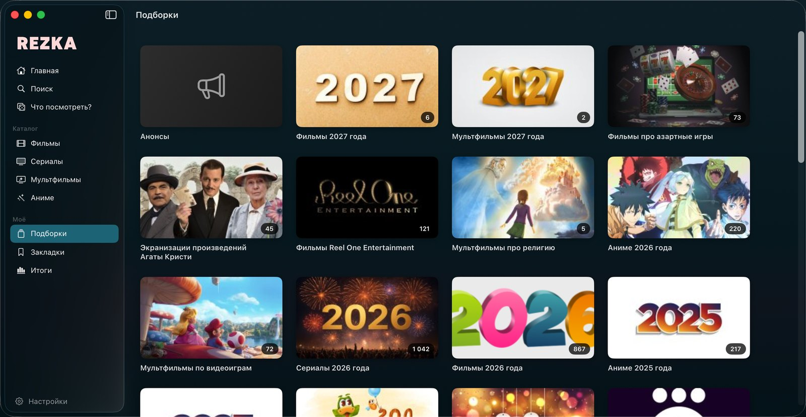</td>
    <td width="50%">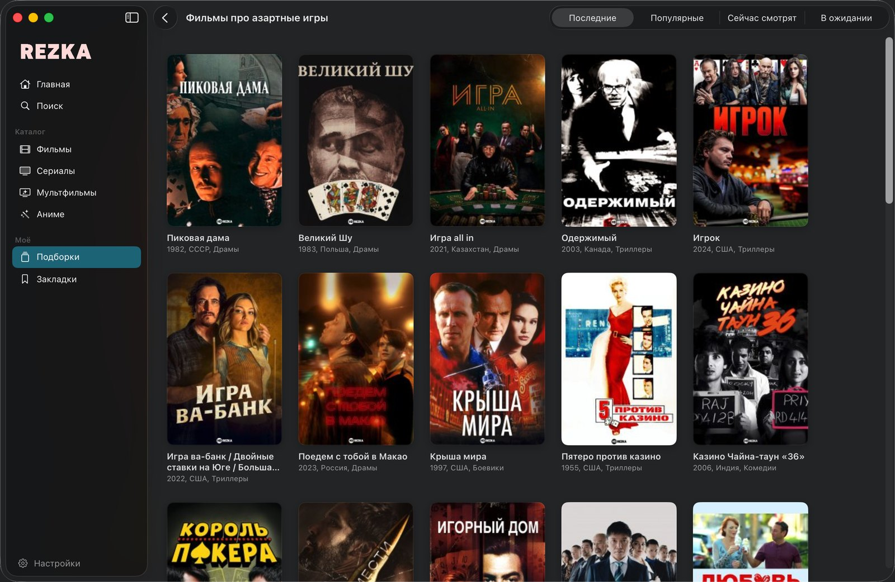</td>
  </tr>
</table>

- Все подборки сайта с обложками и числом тайтлов: «Фильмы 2027 года», «Сериалы Apple TV+», «Экранизации Агаты Кристи»…
- «Анонсы» — ещё не вышедшие фильмы и сериалы.
- Внутри подборки та же сортировка, что в каталоге.

### Карточка фильма и сериала

<table>
  <tr>
    <td width="50%">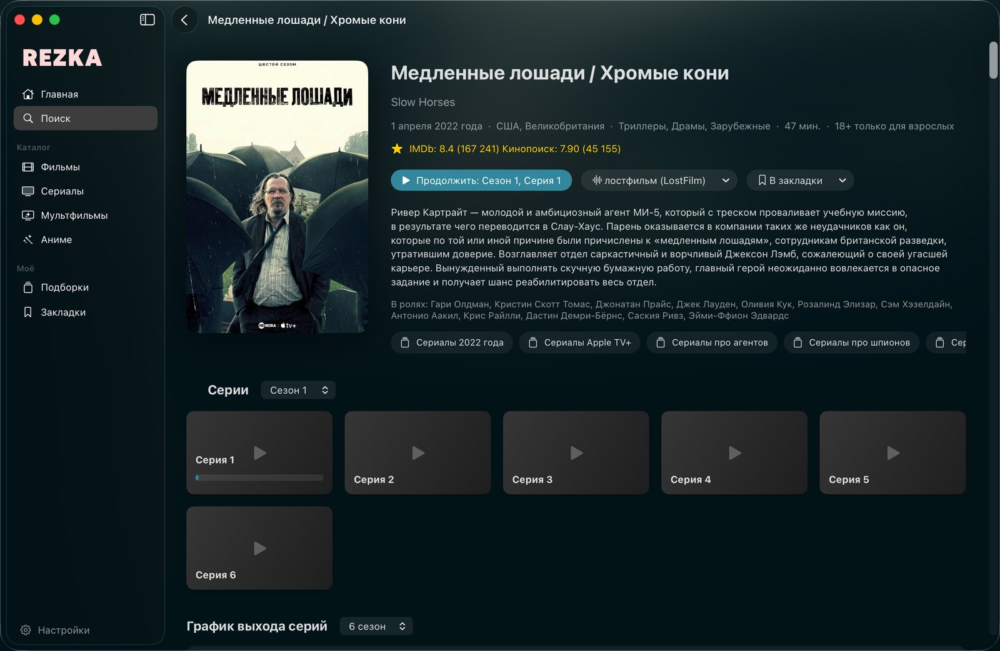</td>
    <td width="50%"></td>
  </tr>
  <tr>
    <td width="50%">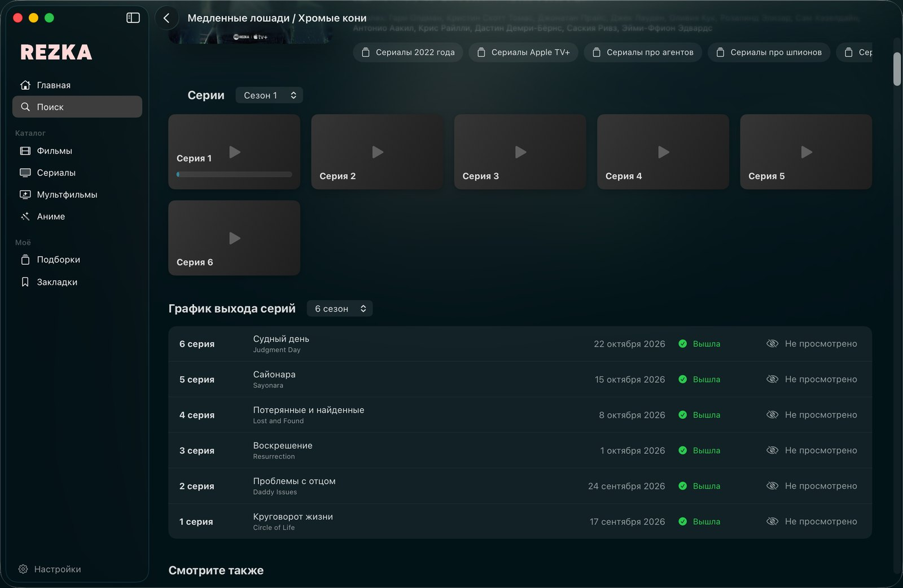</td>
    <td width="50%">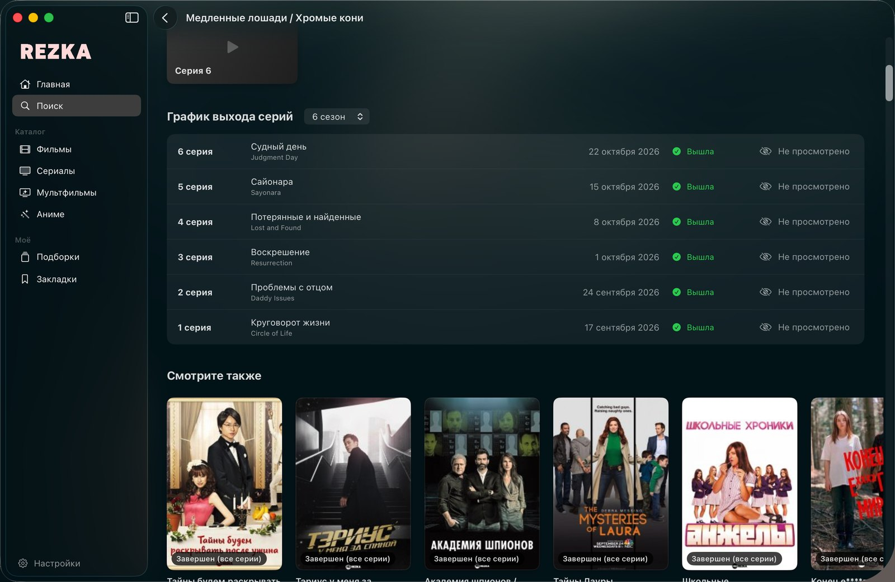</td>
  </tr>
  <tr>
    <td colspan="2" align="center">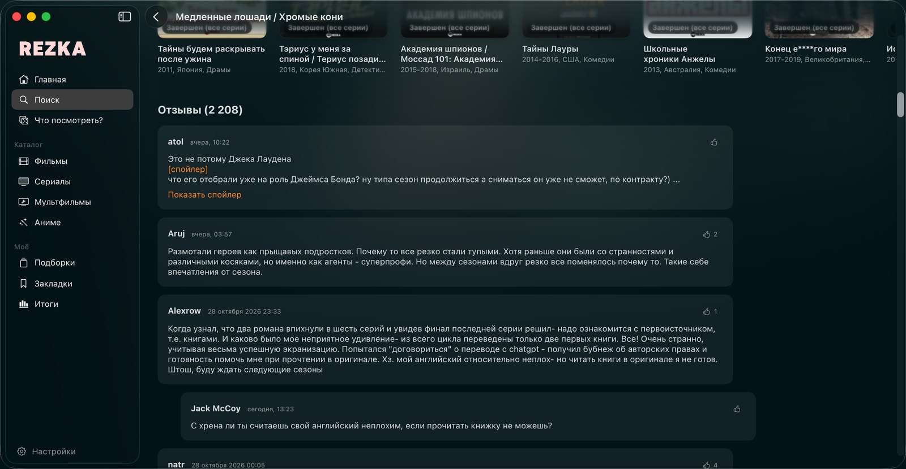</td>
  </tr>
</table>

- Описание, рейтинги IMDb и Кинопоиска, актёры, выбор озвучки (премиум-озвучки помечены и не выбираются без подписки).
- Рейтинг зрителей сайта звёздами и своя оценка от 1 до 10: наведите на звёзды и подтвердите — сайт принимает один голос от аккаунта.
- Кнопка «Продолжить» сразу ставит следующую непросмотренную серию; «Сначала» запускает её с начала.
- Если фильм или сериал ещё не вышел, вместо кнопки «Смотреть» написано «В ожидании».
- Меню «В закладки»: галочки у папок, где уже лежит тайтл; «Новая папка…» создаёт папку и сразу добавляет его туда.
- Сезоны и серии с прогрессом просмотра и отметкой «просмотрено» с сайта; правый клик по серии ставит или снимает отметку.
- «График выхода серий» с датами и кнопкой «Просмотрено» у каждой серии.
- Все части франшизы, строка «Из серии» с подборками, «Смотрите также».
- Режиссёры и актёры с фото: клик открывает страницу человека — карьера, дата и место рождения и все его фильмы и сериалы по ролям.
- Отзывы с ответами и числом лайков; спойлеры скрыты и открываются по клику, «Показать ещё отзывы» подгружает следующие.

### Плеер

<table>
  <tr>
    <td width="50%">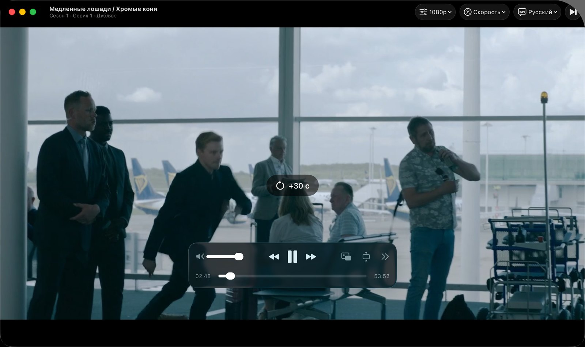</td>
    <td width="50%">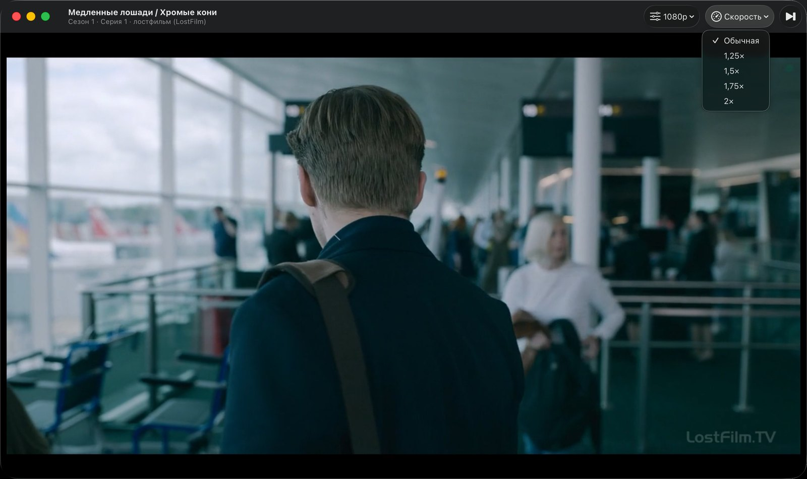</td>
  </tr>
</table>

- Системный плеер macOS в отдельном окне: его можно развернуть на весь экран (⌃⌘F) или вынести в «картинку в картинке».
- В панели окна — «Качество», «Скорость» (1–2×), «Субтитры» и «Следующая серия» (⇧⌘N).
- Субтитры WebVTT поверх видео, продолжение с места остановки, переход к следующей серии в конце.
- Позиция просмотра отправляется на сайт, так что «Продолжить просмотр» совпадает с браузером и Apple TV.

### Закладки, поиск и настройки

<table>
  <tr>
    <td width="50%">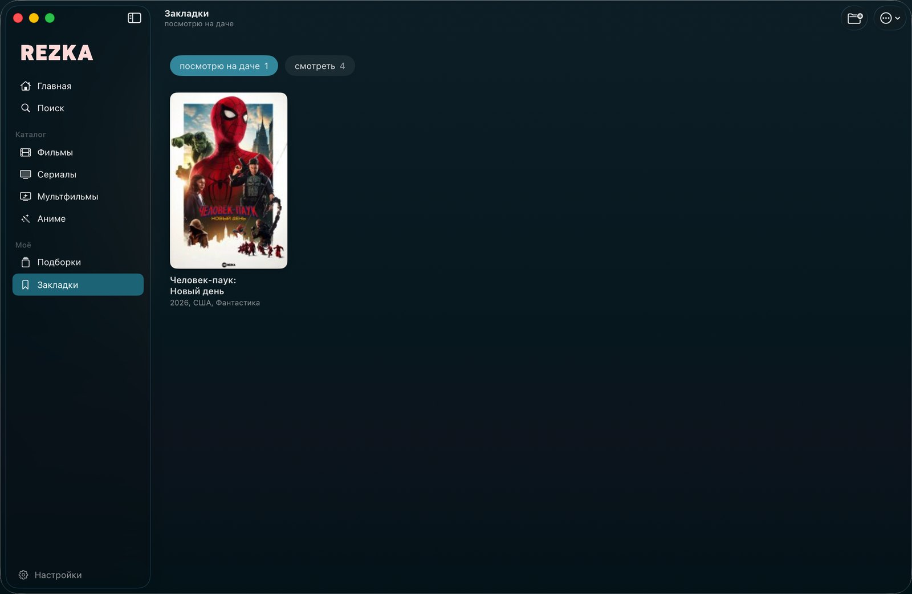</td>
    <td width="50%">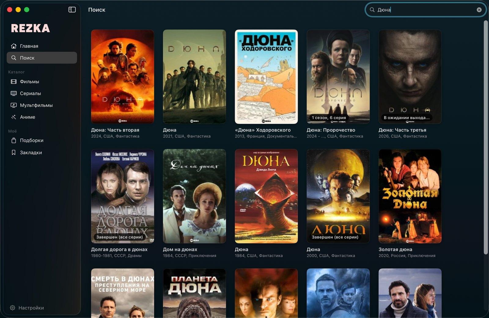</td>
  </tr>
  <tr>
    <td width="50%">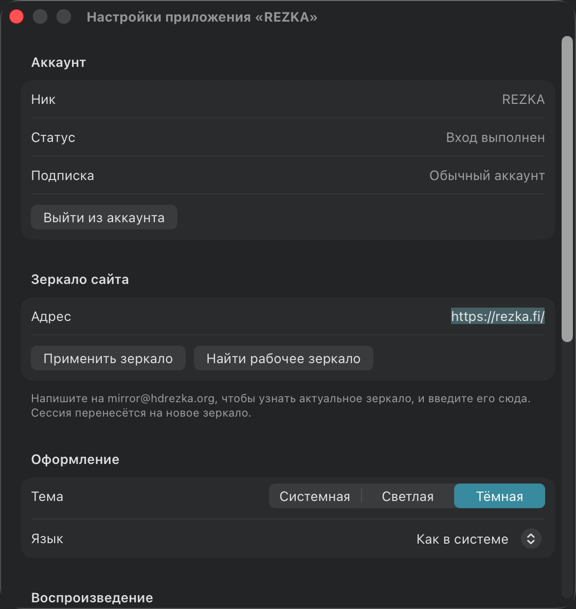</td>
    <td width="50%">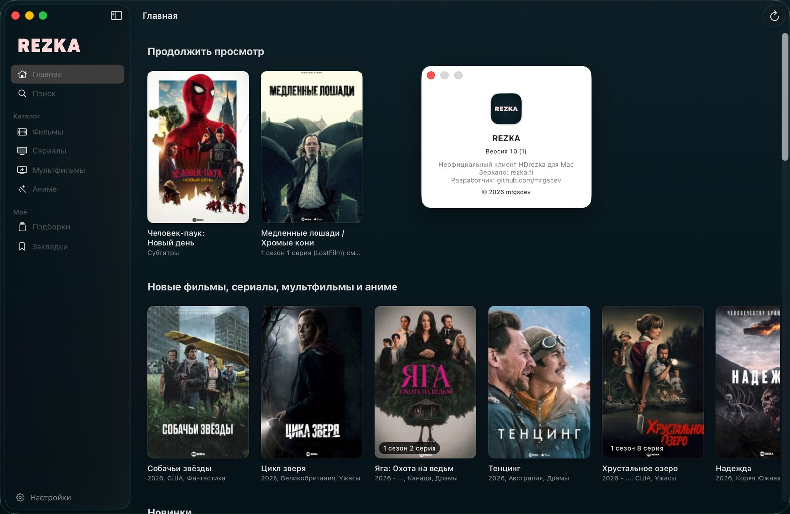</td>
  </tr>
</table>

- Закладки — папки с сайта: создание, переименование, удаление; правый клик по постеру убирает его из папки или переносит в другую.
- Поиск по фильмам, сериалам и мультфильмам в панели окна (⌘F).
- Настройки (⌘,): смена зеркала с переносом сессии и кнопка «Найти рабочее зеркало», которая проверяет известные домены.
  Актуальный адрес приходит в ответ на письмо на mirror@hdrezka.org.
- Ник аккаунта, качество по умолчанию и выход из аккаунта; «О программе REZKA» с версией и текущим зеркалом.
- Оформление: тёмная тема (как на скриншотах), светлая или как в системе — переключается сразу, плеер всегда тёмный.

### Вход в аккаунт

<p align="center">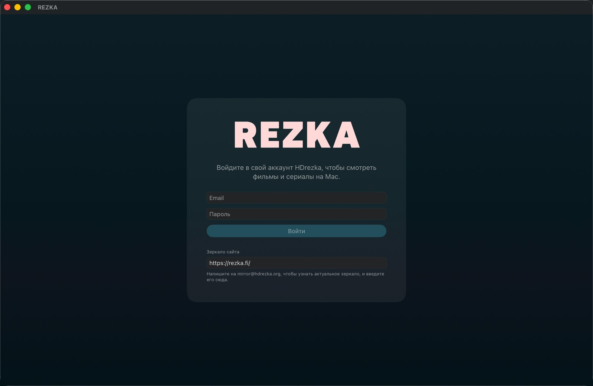</p>

Сайт сейчас пускает к контенту только после входа. Логин и пароль вводятся прямо в окне,
сессия хранится в связке ключей macOS. Зеркало можно поменять ещё до входа.

### Обновления

REZKA сама проверяет [релизы на GitHub](https://github.com/mrgsdev/HDRezka_macOS/releases) при запуске и потом
раз в 12 часов. Если вышла новая версия, открывается окно «Доступна новая версия REZKA»: кнопка «Что нового»
раскрывает список изменений из описания релиза, «Обновить» скачивает новую версию, проверяет, что приложение подписано
тем же разработчиком, ставит его на место старого и перезапускает REZKA. Проверить вручную — меню
«REZKA → Проверить обновления…» или кнопка в настройках.

### Горячие клавиши

| Клавиши | Действие |
| --- | --- |
| ⌘0 | Главное окно (открывает снова, если его закрыли) |
| ⌘1 | Главная |
| ⌘2 – ⌘5 | Фильмы, Сериалы, Мультфильмы, Аниме |
| ⌘6 / ⌘7 | Подборки / Закладки |
| ⌘F | Поиск |
| ⌘R | Обновить главную |
| ⌘, | Настройки |
| ↩ | Смотреть или продолжить в карточке |
| Пробел | Пауза и воспроизведение в плеере |
| ← → | Перемотка на 10 секунд назад или вперёд в плеере |
| ⇧⌘N | Следующая серия |
| ⌃⌘F | Плеер на весь экран |
| ⌘W | Закрыть плеер (позиция сохраняется) |
| ⌘/ | Все горячие клавиши (меню «Справка») |

## Установка

1. Скачайте `REZKA-<версия>.dmg` со страницы [Releases](https://github.com/mrgsdev/HDRezka_macOS/releases/latest),
   откройте его и перетащите **REZKA** на папку «Программы» в том же окне.
2. Приложение не нотарифицировано Apple, поэтому при первом запуске macOS его не откроет. Откройте
   «Системные настройки → Конфиденциальность и безопасность», внизу нажмите «Всё равно открыть» у REZKA
   и подтвердите паролем. Или одной командой в Терминале:

   ```bash
   xattr -dr com.apple.quarantine /Applications/REZKA.app
   ```

Дальше REZKA обновляется сама.

## Сборка из исходников

Нужен Xcode 26+, macOS 15+.

```bash
open REZKA.xcodeproj
```

Swift Package SwiftSoup подтянется автоматически.

1. Xcode → Settings → Accounts — добавить Apple ID (подойдёт бесплатный Personal Team).
2. Target **REZKA** → Signing & Capabilities → выбрать свой Team (если Xcode ругается на Bundle ID —
   поменять его на любой свой, например `com.<имя>.hdrezkamac`).
3. Нажать Run (⌘R).

Чтобы положить приложение в «Программы», соберите Release и скопируйте его:

```bash
./scripts/make-release.sh
```

```bash
cp -R build/Build/Products/Release/REZKA.app /Applications/
```

Если после пересборки macOS спросит доступ к связке ключей — там хранится сессия сайта, нажмите «Всегда разрешать».

## Выпуск новой версии

1. Target **REZKA** → General → поднять **Version** (например, `2.0`) и **Build** (`2`).
2. Собрать файлы для релиза — появятся `build/REZKA-<версия>.dmg` и `build/REZKA-<версия>.zip`:

   ```bash
   ./scripts/make-release.sh
   ```

3. GitHub → Releases → Draft a new release: тег `v<версия>` (например, `v2.0`), название `REZKA 2.0`,
   в описании — список изменений (его пользователи увидят под «Что нового»), приложить оба файла из шага 2, Publish.
   `.dmg` — для скачивания, `.zip` — для обновления из приложения: читать подключённый образ macOS
   разрешает только с согласия пользователя, поэтому новая версия ставится из zip.

Приложение берёт последний опубликованный релиз: черновики и pre-release до пользователей не доходят — ими удобно
проверить обновление на себе. Подписывать новую версию нужно тем же сертификатом, иначе REZKA откажется её ставить.

## Структура проекта

```
REZKA/
  App/          точка входа, окна главного экрана и плеера, меню и горячие клавиши
  Shared/       общий с версией для Apple TV код:
    Core/         зеркало, меню сайта (жанры), cookies в Keychain, сессия, прогресс просмотра
    Network/      RezkaClient — все запросы к сайту
    Parsing/      HTML-парсер (SwiftSoup), декодер ссылок на видео, WebVTT
    Models/       модели данных сайта
  ViewModels/   данные экранов: главная, подборки, закладки, карточка, пагинация
  Features/     экраны: Main, Home, Catalog, Collections, Search, Bookmarks, Details, Player, Auth, Settings, Updates
  UI/           общие компоненты (постеры, полки, сетка, пагинация, подсветка при наведении)
Config/         Info.plist
scripts/        make-release.sh — сборка .dmg и .zip для релиза
```

Все CSS-селекторы собраны в `REZKA/Shared/Parsing/RezkaParser.swift` — если сайт поменяет вёрстку, править нужно там.
Папка `Shared` скопирована из [HDRezka_Apple_TV](https://github.com/mrgsdev/HDRezka_Apple_TV), так что исправления парсера стоит переносить в оба проекта.

## Отладка

- Запросы к сайту пишутся в системный лог (путь, статус, размер, время — без cookies):
  `log stream --predicate 'subsystem == "com.mrgsdev.hdrezkamac"'`
- Аргументы запуска (Scheme → Run → Arguments):
  - `-disableRemoteProgress YES` — не отправлять позицию просмотра на сайт (для тестов);
  - `-dumpHTTP YES` (Debug) — сохранять ответы сайта в `~/Library/Caches/http-debug` для проверки парсера.
  - `-updateFeedURL file:///путь/feed.json` (Debug) — брать «последний релиз» из локального JSON в формате
    GitHub API вместо GitHub, чтобы проверить окно обновления и установку без публикации релиза.
- Сайт подвисает на пачках параллельных запросов, поэтому `RezkaClient` пускает не больше 3 одновременно.
- Премиум-качества («1080p Ultra») для бесплатного аккаунта отдаются минутным тизером — по умолчанию они не выбираются.
- Пустой список сайт отдаёт обычной страницей со статусом 404 — приложение показывает его как пустой, а не как ошибку.

## Благодарности

Разбор API и идеи взяты из открытых проектов
[rezka-payer](https://github.com/Agnidia/rezka-payer) и
[hdrezka-swiftui](https://github.com/voidboost/hdrezka-swiftui) (MIT).

## ⚠️ Отказ от ответственности

* Эта программа предоставляется «как есть».
* Проект не связан с HDrezka и не является его официальным клиентом.
* Автор не поощряет какую-либо незаконную деятельность.
* Используйте её исключительно на свой страх и риск и соблюдайте законы своей страны.
* Также рекомендуется ознакомиться с [правилами сайта](https://rezka.ag/rules/).
