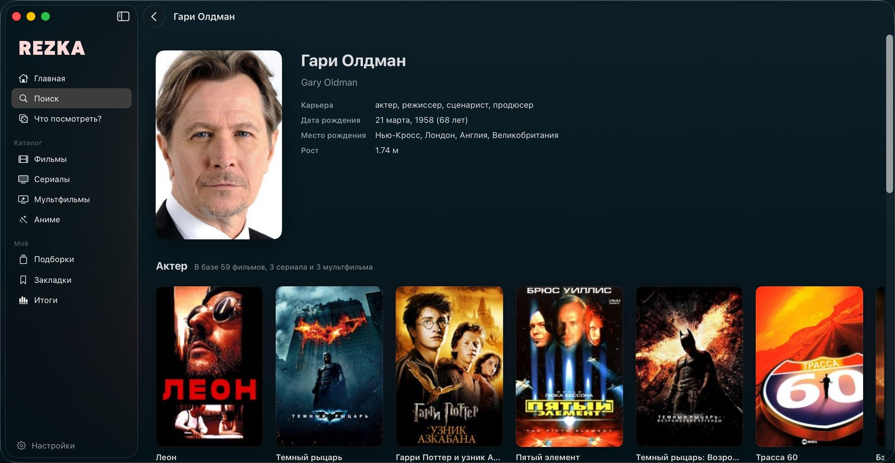
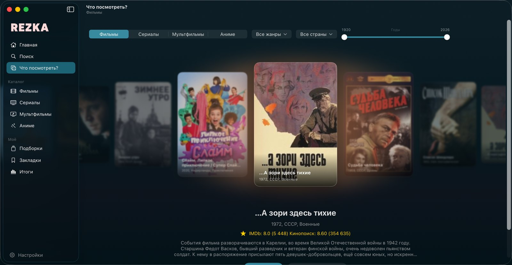
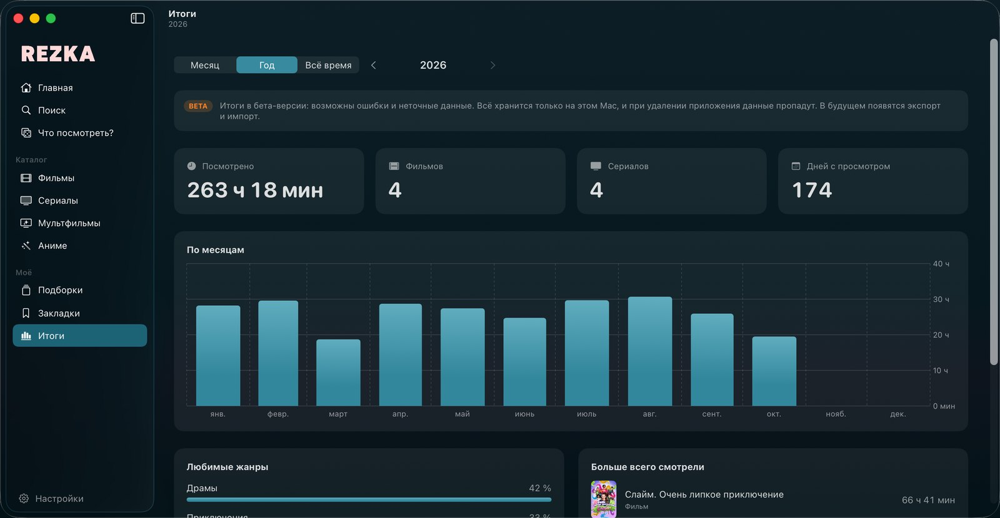
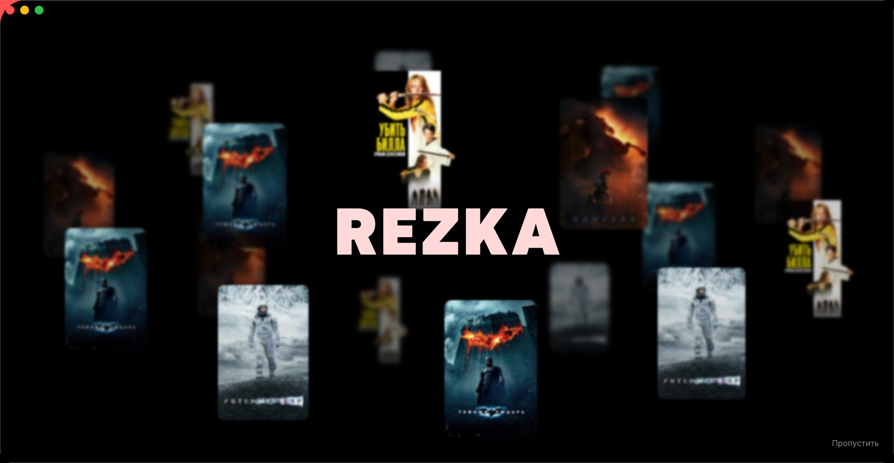
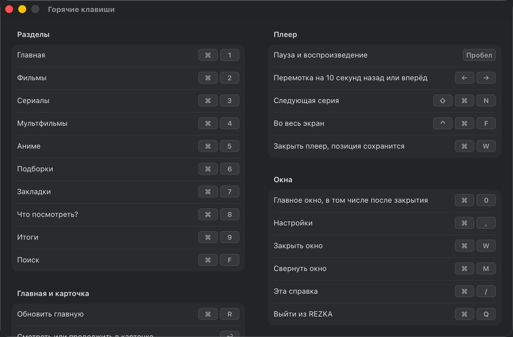
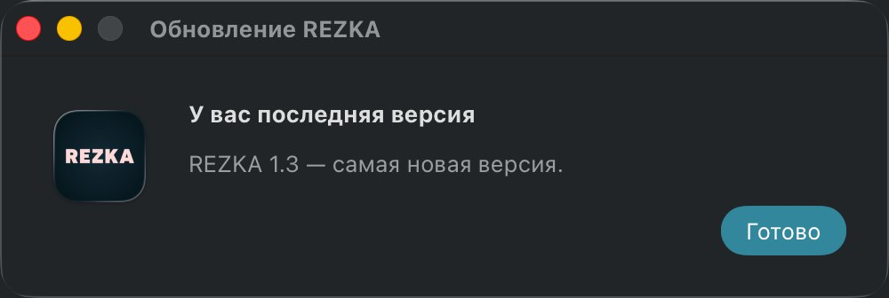
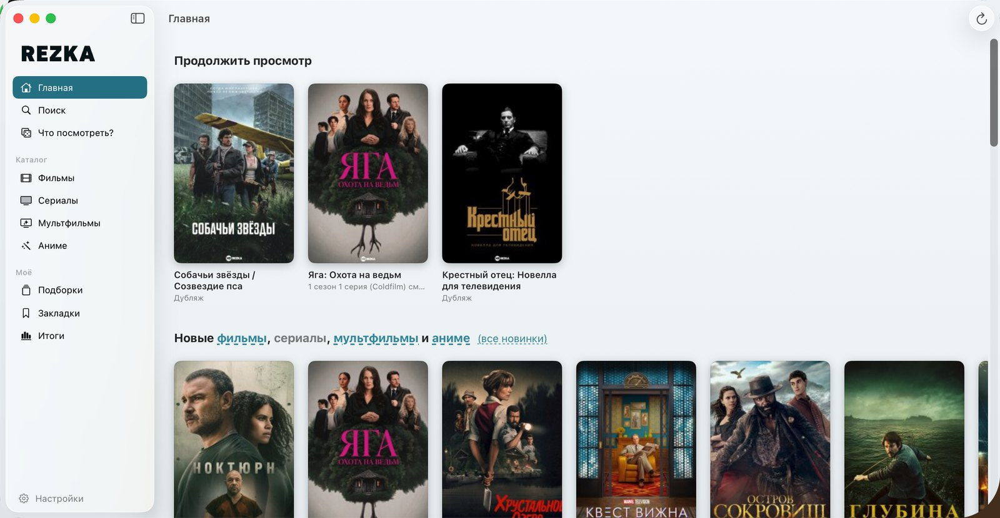

<p align="center">
  
</p>

<h1 align="center">REZKA — HDrezka для macOS</h1>

<p align="center">
  Неофициальный нативный клиент HDrezka для Mac на SwiftUI и AVKit.<br>
  Фильмы, сериалы, мультфильмы и аниме в настоящем macOS-приложении — и то, чего нет на сайте.
</p>

<p align="center">
  <a href="https://github.com/mrgsdev/HDRezka_macOS/releases/latest"></a>
</p>

<p align="center">
  
  
  
  
  
</p>

<p align="center">
  📬 <a href="mailto:mrgsdev@gmail.com">mrgsdev@gmail.com</a> &nbsp;·&nbsp;
  📺 <a href="https://github.com/mrgsdev/HDRezka_Apple_TV">Версия для Apple TV</a>
</p>

---

## Коротко

**Всё, что есть на сайте:** главная с полками, каталоги с жанрами, студиями и «Лучшими», подборки и анонсы,
поиск, карточка с рейтингами, оценкой и озвучками, сезоны и график выхода серий, отзывы с лайками,
страницы актёров и режиссёров, закладки по папкам, «Продолжить просмотр» синхронно с сайтом, смена зеркала.

**Чего нет на сайте:** рулетка «Что посмотреть?» с фильтрами, «Итоги» просмотра, заставка, нативный плеер
с перемоткой стрелками и картинкой в картинке, горячие клавиши, обновление из приложения, светлая тема
и английский интерфейс.

## Содержание

- [Что есть на сайте — и в приложении](#что-есть-на-сайте--и-в-приложении)
- [Чего нет на сайте](#чего-нет-на-сайте)
- [Установка](#установка)
- [Для разработчиков](#для-разработчиков)
- [Благодарности](#благодарности) · [Лицензия](#лицензия) · [Отказ от ответственности](#отказ-от-ответственности)

---

## Что есть на сайте — и в приложении

### 🏠 Главная

«Продолжить просмотр» с сайта, новинки с выбором раздела, популярные фильмы и сериалы, «Сейчас смотрят».
Полки листаются стрелками и Shift + колёсиком, ⌘R обновляет.


### 🎬 Каталог, жанры и «Лучшие»

Фильмы, сериалы, мультфильмы и аниме с бесконечной прокруткой. Жанры и студии берутся из меню сайта,
сортировка — «Последние», «Популярные», «Сейчас смотрят», «В ожидании» и «Лучшие» за любой год.


### 🗂 Подборки и анонсы

Все подборки сайта («Фильмы 2026 года», «Сериалы Apple TV+»…) и анонсы.


### 🔍 Поиск

Поиск по фильмам, сериалам и мультфильмам прямо в панели окна (⌘F).


### 🎞 Карточка фильма и сериала

Рейтинги IMDb и Кинопоиска, оценка по шкале сайта, выбор озвучки с подсказкой «какую выбирают зрители»,
закладки, режиссёры и актёры, списки «Лучших» и подборки, в которые входит тайтл. Если видео недоступно
в вашем регионе, карточка так и скажет.


### 📺 Сезоны, серии и график выхода

Серии с полосками просмотра, график выхода с отметками «просмотрено», которые синхронизируются с сайтом.


### 💬 Отзывы

Отзывы с ответами, спрятанные спойлеры и лайки «Поддерживаю!».


### 🎭 Актёры и режиссёры

Страница человека со всеми его фильмами и сериалами на сайте.



### 🔖 Закладки

Папки закладок с сайта: создание, переименование, удаление, перенос тайтлов между папками.


### 🔐 Вход и зеркала

Вход в аккаунт HDrezka, сессия хранится в связке ключей macOS. Зеркало можно сменить ещё до входа,
а «Найти рабочее зеркало» в настройках проверит известные адреса.


---

## Чего нет на сайте

### 🎲 Что посмотреть?

Лента постеров раскручивается и останавливается на случайном фильме или сериале — или сразу, кнопкой
«Без анимации». Фильтры как в «Случайном фильме» Кинопоиска: раздел, несколько жанров, страны и годы. ⌘8.



### 📊 Итоги <sub>бета</sub>

Сколько посмотрено за месяц, год или всё время, график по дням и месяцам, любимые жанры и самые
просматриваемые тайтлы. Считается то, что играло в REZKA на этом Mac; данные хранятся только локально. ⌘9.


<sub>На скриншоте — примерные данные.</sub>

### ✨ Заставка

Перед входом постеры кружат вокруг логотипа, а затем постер «Одиссеи» разворачивается в экран входа.



### ▶️ Нативный плеер

Плеер macOS в отдельном окне: перемотка стрелками на 10 секунд с подсказкой «+30 с», скорость до 2×,
выбор качества и субтитров, «Следующая серия», картинка в картинке, полный экран, значок загрузки
при подгрузке видео. Позиция запоминается и уходит на сайт.


### ⌨️ Горячие клавиши

Все разделы, поиск, плеер и окна — с клавиатуры. Полный список — в меню «Справка» (⌘/).

<p align="center"></p>

<details>
<summary>Список текстом</summary>

| Клавиши | Действие |
| --- | --- |
| ⌘0 | Главное окно (открывает снова, если его закрыли) |
| ⌘1 | Главная |
| ⌘2 – ⌘5 | Фильмы, Сериалы, Мультфильмы, Аниме |
| ⌘6 / ⌘7 | Подборки / Закладки |
| ⌘8 / ⌘9 | Что посмотреть? / Итоги |
| ⌘F | Поиск |
| ⌘R | Обновить главную |
| ⌘, | Настройки |
| ↩ | Смотреть или продолжить в карточке |
| Пробел | Пауза и воспроизведение в плеере |
| ← → | Перемотка на 10 секунд назад или вперёд |
| ⇧⌘N | Следующая серия |
| ⌃⌘F | Плеер на весь экран |
| ⌘W | Закрыть плеер (позиция сохраняется) |
| ⌘/ | Все горячие клавиши |

</details>

### 🔄 Обновление из приложения

REZKA сама находит новый релиз на GitHub, показывает «Что нового» и ставит обновление одной кнопкой.

<p align="center"></p>

### 🌗 Светлая и тёмная тема

Тёмная, светлая или как в системе — переключается сразу, плеер всегда тёмный.



### 🇬🇧 Английский интерфейс

Язык системы или выбор в настройках. Названия и описания приходят с сайта и остаются на русском.


### ⚙️ Настройки

Ник аккаунта и Premium, зеркало, тема и язык, качество по умолчанию, размер кэша с кнопкой очистки.
Там же и в меню «Справка» — отказ от ответственности и лицензии.

<p align="center"></p>

---

## Установка

1. Скачайте `REZKA-<версия>.dmg` со страницы [Releases](https://github.com/mrgsdev/HDRezka_macOS/releases/latest),
   откройте его и перетащите **REZKA** на папку «Программы» в том же окне.
2. Приложение не нотарифицировано Apple, поэтому при первом запуске macOS его не откроет. Откройте
   «Системные настройки → Конфиденциальность и безопасность», внизу нажмите «Всё равно открыть» у REZKA
   и подтвердите паролем. Или одной командой в Терминале:

   ```bash
   xattr -dr com.apple.quarantine /Applications/REZKA.app
   ```

Дальше REZKA обновляется сама.

## Для разработчиков

<details>
<summary><b>Сборка из исходников</b></summary>

Нужен Xcode 26+, macOS 15+.

```bash
open REZKA.xcodeproj
```

Swift Package SwiftSoup подтянется автоматически.

1. Xcode → Settings → Accounts — добавить Apple ID (подойдёт бесплатный Personal Team).
2. Target **REZKA** → Signing & Capabilities → выбрать свой Team (если Xcode ругается на Bundle ID —
   поменять его на любой свой, например `com.<имя>.hdrezkamac`).
3. Нажать Run (⌘R).

Чтобы положить приложение в «Программы», соберите Release и скопируйте его:

```bash
./scripts/make-release.sh
```

```bash
cp -R build/Build/Products/Release/REZKA.app /Applications/
```

Если после пересборки macOS спросит доступ к связке ключей — там хранится сессия сайта, нажмите «Всегда разрешать».

</details>

<details>
<summary><b>Выпуск новой версии</b></summary>

1. Target **REZKA** → General → поднять **Version** (например, `2.0`) и **Build** (`2`).
2. Собрать файлы для релиза — появятся `build/REZKA-<версия>.dmg` и `build/REZKA-<версия>.zip`:

   ```bash
   ./scripts/make-release.sh
   ```

3. GitHub → Releases → Draft a new release: тег `v<версия>` (например, `v2.0`), название `REZKA 2.0`,
   в описании — список изменений (его пользователи увидят под «Что нового»), приложить оба файла из шага 2, Publish.
   `.dmg` — для скачивания, `.zip` — для обновления из приложения: читать подключённый образ macOS
   разрешает только с согласия пользователя, поэтому новая версия ставится из zip.

Приложение берёт последний опубликованный релиз: черновики и pre-release до пользователей не доходят — ими удобно
проверить обновление на себе. Подписывать новую версию нужно тем же сертификатом, иначе REZKA откажется её ставить.

</details>

<details>
<summary><b>Структура проекта</b></summary>

```
REZKA/
  App/          точка входа, окна главного экрана и плеера, меню и горячие клавиши
  Shared/       общий с версией для Apple TV код:
    Core/         зеркало, меню сайта (жанры), cookies в Keychain, сессия, прогресс просмотра
    Network/      RezkaClient — все запросы к сайту
    Parsing/      HTML-парсер (SwiftSoup), декодер ссылок на видео, WebVTT
    Models/       модели данных сайта
  ViewModels/   данные экранов: главная, подборки, закладки, карточка, рулетка, пагинация
  Features/     экраны: Main, Home, Catalog, Collections, Search, Roulette, Stats, Bookmarks, Details,
                Person, Player, Auth, Settings, Help, Updates
  UI/           общие компоненты (постеры, полки, сетка, пагинация, подсветка при наведении)
  Localizable.xcstrings  строки интерфейса: русский (исходный) и английский
Config/         Info.plist
scripts/        make-release.sh — сборка .dmg и .zip для релиза
```

Все CSS-селекторы собраны в `REZKA/Shared/Parsing/RezkaParser.swift` — если сайт поменяет вёрстку, править нужно там.
Папка `Shared` скопирована из [HDRezka_Apple_TV](https://github.com/mrgsdev/HDRezka_Apple_TV), так что исправления
парсера стоит переносить в оба проекта.

</details>

<details>
<summary><b>Отладка</b></summary>

- Запросы к сайту пишутся в системный лог (путь, статус, размер, время — без cookies):
  `log stream --predicate 'subsystem == "com.mrgsdev.hdrezkamac"'`
- Аргументы запуска (Scheme → Run → Arguments):
  - `-disableRemoteProgress YES` — не отправлять позицию просмотра на сайт (для тестов);
  - `-dumpHTTP YES` (Debug) — сохранять ответы сайта в `~/Library/Caches/http-debug` для проверки парсера;
  - `-updateFeedURL file:///путь/feed.json` (Debug) — брать «последний релиз» из локального JSON в формате
    GitHub API вместо GitHub, чтобы проверить окно обновления и установку без публикации релиза.
- Сайт подвисает на пачках параллельных запросов, поэтому `RezkaClient` пускает не больше 3 одновременно.
- Премиум-качества («1080p Ultra») для бесплатного аккаунта отдаются минутным тизером — по умолчанию они не выбираются.
- Пустой список сайт отдаёт обычной страницей со статусом 404 — приложение показывает его как пустой, а не как ошибку.

</details>

## Благодарности

Разбор API и идеи взяты из открытых проектов
[rezka-payer](https://github.com/Agnidia/rezka-payer) и
[hdrezka-swiftui](https://github.com/voidboost/hdrezka-swiftui) (MIT).

## Лицензия

[MIT](LICENSE). Лицензии открытых библиотек — в приложении: «Справка → Отказ от ответственности и лицензии».

## Отказ от ответственности

* Эта программа предоставляется «как есть».
* Проект не связан с HDrezka и не является его официальным клиентом.
* Автор не поощряет какую-либо незаконную деятельность.
* Используйте её исключительно на свой страх и риск и соблюдайте законы своей страны.
* Также рекомендуется ознакомиться с [правилами сайта](https://rezka.ag/rules/).
